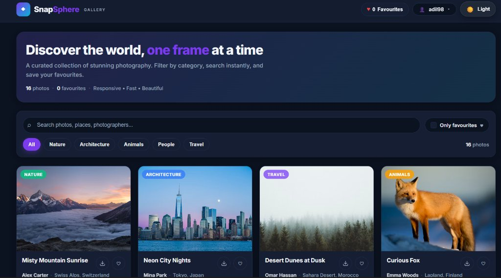
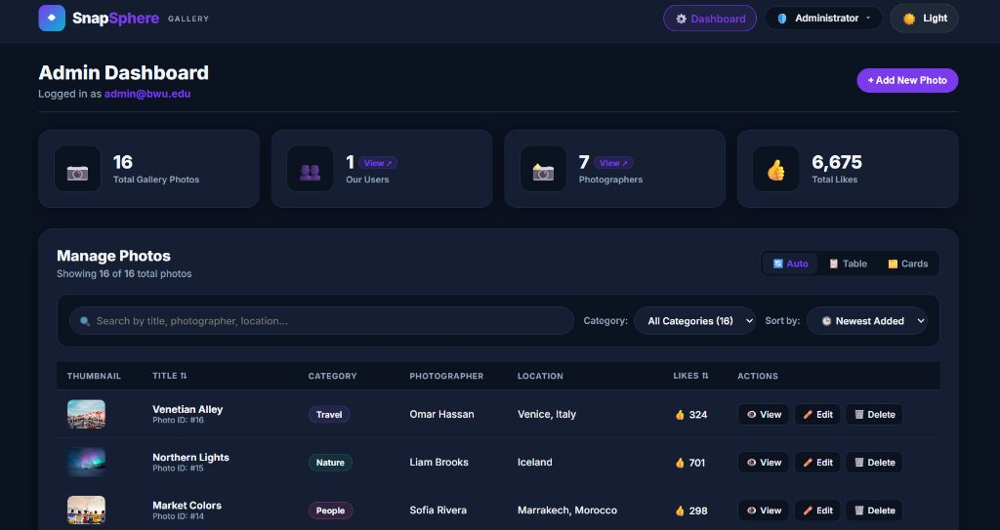
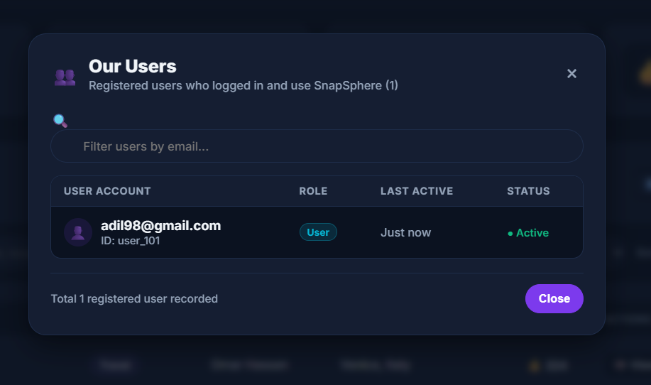
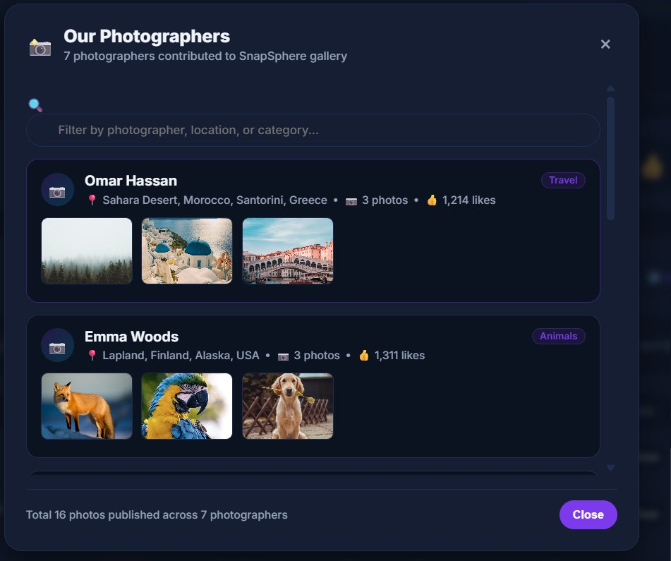
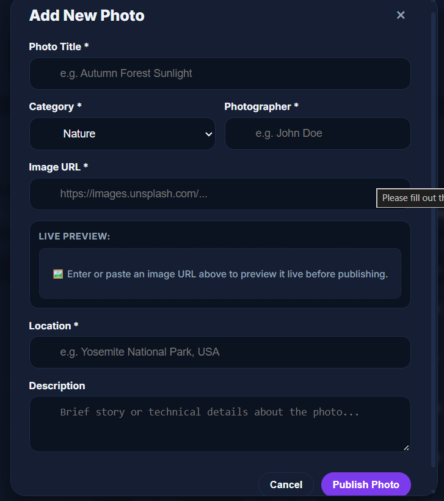
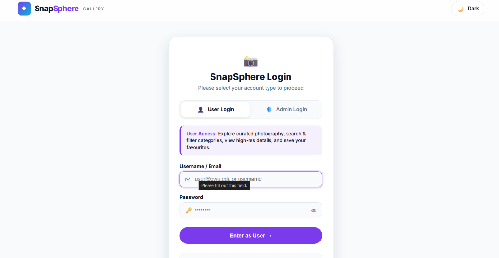
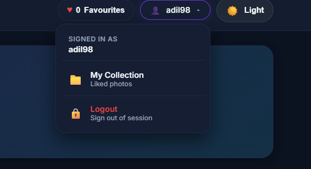

# SnapSphere 📸 — Modern Responsive Photo Gallery & Management Platform (MERN)

A fast, responsive, and full-stack photo gallery web application built with the **MERN Stack**: **React 19**, **Node.js**, **Express**, **MongoDB Atlas (Mongoose)**, and **CSS3**. SnapSphere features public gallery exploration, high-resolution photo inspection, instant downloads, user collections, and an **Administration Dashboard** with user and photographer tracking.

---

## 📸 Application Showcase & Screenshots

### 🌟 1. Explore Gallery & Photo Details
Explore high-resolution curated photography with instant live search, instant category pills, and deep detail inspection.

| Gallery Home (Dark Mode & Filters) | Photo Detail Page (Metadata & Likes) |
|:---:|:---:|
|  |  |

---

### 🛡️ 2. Comprehensive Admin Dashboard
Monitor platform statistics in real time, filter catalog items, sort records, and manage gallery items directly.

| Admin Dashboard (Analytics & Photo Management) | Real-Time Category Filtering |
|:---:|:---:|
|  |  |

---

### 👥 3. Interactive Modals: Users & Photographers
Track active registered community members and spotlight featured photographers across global locations.

| Our Users Modal | Our Photographers Modal |
|:---:|:---:|
|  |  |

---

### 🎨 4. Add & Edit Photo Workflows
Add new photos or edit existing photo details with real-time URL image validation and responsive modal scrolling.

| Add New Photo Modal | Edit Photo Details Modal |
|:---:|:---:|
|  |  |

---

### 🔐 5. Authentication & Personalized Collection
Unified login switcher for standard Users and credentialed Administrators, paired with individual collections of liked and favourited shots.

| Unified Login Portal | User Profile & Navigation |
|:---:|:---:|
|  |  |

| My Collection Page (Liked & Favourites) |
|:---:|
|  |

---

## ✨ Key Features

### 👤 User Features
- **🖼️ Curated Photo Gallery**: High-quality imagery displayed in an adaptive responsive grid with smooth hover transitions.
- **🔍 Real-Time Search**: Instant filtering by photo title, photographer name, location, and description.
- **🏷️ Category Filtering**: Filter seamlessly between *All*, *Nature*, *Architecture*, *Travel*, *Animals*, *People*, and *Street*.
- **⬇️ Instant Photo Downloads**: Direct high-resolution image downloads directly from gallery cards or detail pages.
- **❤️ Favorites & Likes**: Save favorite shots and like photos with immediate visual feedback.
- **📁 My Collection (`/collection`)**: Dedicated user space with interactive tabs to switch between *Total Liked Photos* and *Favourites Saved*.
- **🌗 Dark / Light Mode**: System-aware theme toggle with persistent user preference across sessions.
- **📄 Deep Photo Detail Page (`/photo/:id`)**: High-res display with complete metadata, photographer info, location, like counters, and related recommendations.

### 🛡️ Administration Section (`/admin`)
- **🔐 Unified Authentication Flow**: Tabbed role switcher supporting credentialed Admin access (`admin@bwu.edu` / `admin123`) and User access.
- **📊 Real-Time Metric Cards**:
  - **Total Gallery Photos**: Live count of all catalog items.
  - **👥 Our Users**: Interactive modal listing registered user emails, active status badges, and login activity.
  - **📸 Photographers**: Interactive modal showing unique artists, shot locations, total likes, and a horizontal gallery strip of their photos.
  - **👍 Total Likes**: Aggregate community engagement across all photos.
- **🔎 Table Search, Filter & Multi-Sort**: Search photos by title, photographer, or location, filter by category, and sort by Newest, Oldest, Most Liked, or Title (A-Z / Z-A).
- **🖼️ Live Image Preview in Add/Edit Modal**: Instant URL preview with real-time image validation before publishing, featuring smooth modal scrolling on all devices.
- **👁️ Quick "View in Gallery" Action**: Direct row links to inspect the public photo page in a new tab.
- **📱 Responsive Mobile/Desktop UX**: Horizontal scrolling table for desktop and tablet screens, adaptive card grid for mobile devices, and a manual `Auto | Table | Cards` view switcher.

---

## 📁 Architecture: Clean Client & Server

The repository is organized into two completely independent, self-contained directories:

```text
snap-sphere/
├── client/                     # ⚛️ React 19 Frontend Application
│   ├── public/                 # Static assets, favicon, index.html
│   ├── src/                    # Components, pages, styling, utils
│   ├── package.json            # React frontend scripts and dependencies
│   ├── package-lock.json
│   └── .gitignore
│
├── server/                     # 🚀 Node.js + Express + MongoDB Backend API
│   ├── models/                 # Mongoose schemas (Photo.js, User.js)
│   ├── routes/                 # REST API endpoints (photoRoutes.js, authRoutes.js)
│   ├── middleware/             # JWT auth & admin role verification (auth.js)
│   ├── seedData.js             # Initial 16 gallery photos auto-seeder
│   ├── server.js               # Express server entry point & DB connection
│   ├── .env.example            # Environment template
│   ├── package.json            # Backend scripts and dependencies
│   └── .gitignore
│
├── docs/                       # 📸 Application Documentation & Screenshots
│   └── screenshots/
│
├── .gitignore                  # Root gitignore
├── LICENSE                     # MIT License
└── README.md
```

---

## 🛠️ Tech Stack

- **Frontend**: [React 19](https://react.dev/), [React Router v6](https://reactrouter.com/)
- **Backend**: [Node.js](https://nodejs.org/), [Express.js](https://expressjs.com/)
- **Database**: [MongoDB Atlas](https://www.mongodb.com/atlas) with [Mongoose](https://mongoosejs.com/)
- **Authentication**: JSON Web Tokens (JWT) & bcrypt.js
- **Styling**: Vanilla CSS3 with Custom Properties (Theme tokens, Grid, Flexbox, Animations)
- **Testing**: [Jest](https://jestjs.io/) & [React Testing Library](https://testing-library.com/)

---

## 🚀 Getting Started

### Prerequisites
Make sure you have [Node.js](https://nodejs.org/) (v16 or higher) and [npm](https://www.npmjs.com/) installed on your machine.

### Clone the Repository
```bash
git clone https://github.com/adilmairaj-dev/Snap-Sphere.git
cd Snap-Sphere
```

---

### Running the Application

Open two terminal tabs:

#### 1. Frontend (Client)
```bash
cd client
npm install
npm start
```
- Local URL: **`http://localhost:3000`**

#### 2. Backend (Server)
```bash
cd server
npm install
npm start
# or during development with live reload:
npm run dev
```
- API URL: **`http://localhost:5000`**

---

## 🧪 Testing

To run the frontend unit & integration test suite:
```bash
cd client
npm test
```

---

## 👨‍💻 Author

**Adil Mairaj**
- GitHub: [@adilmairaj-dev](https://github.com/adilmairaj-dev)

---

## 📄 License
This project is open source and available under the [MIT License](LICENSE).
