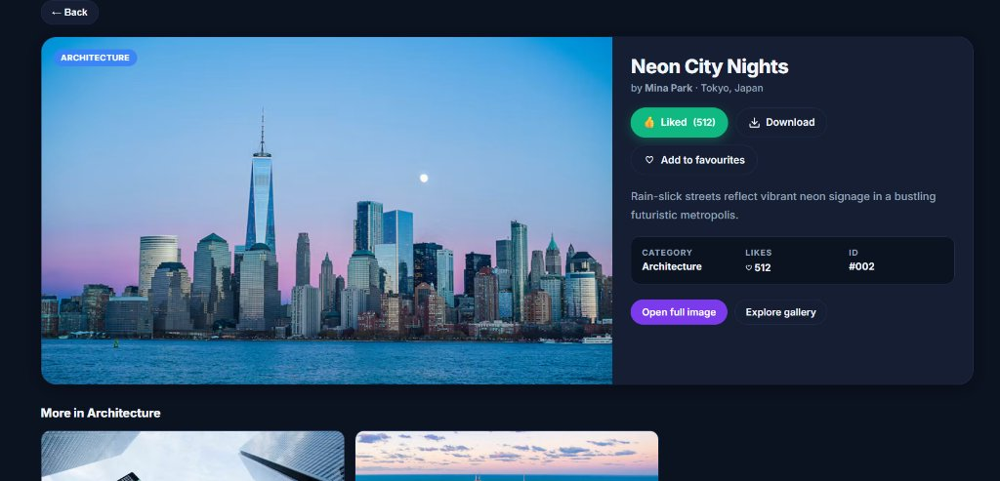
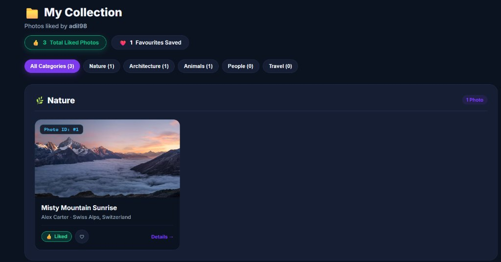
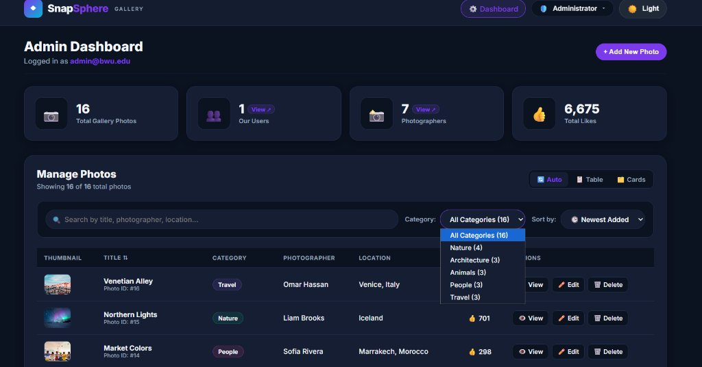
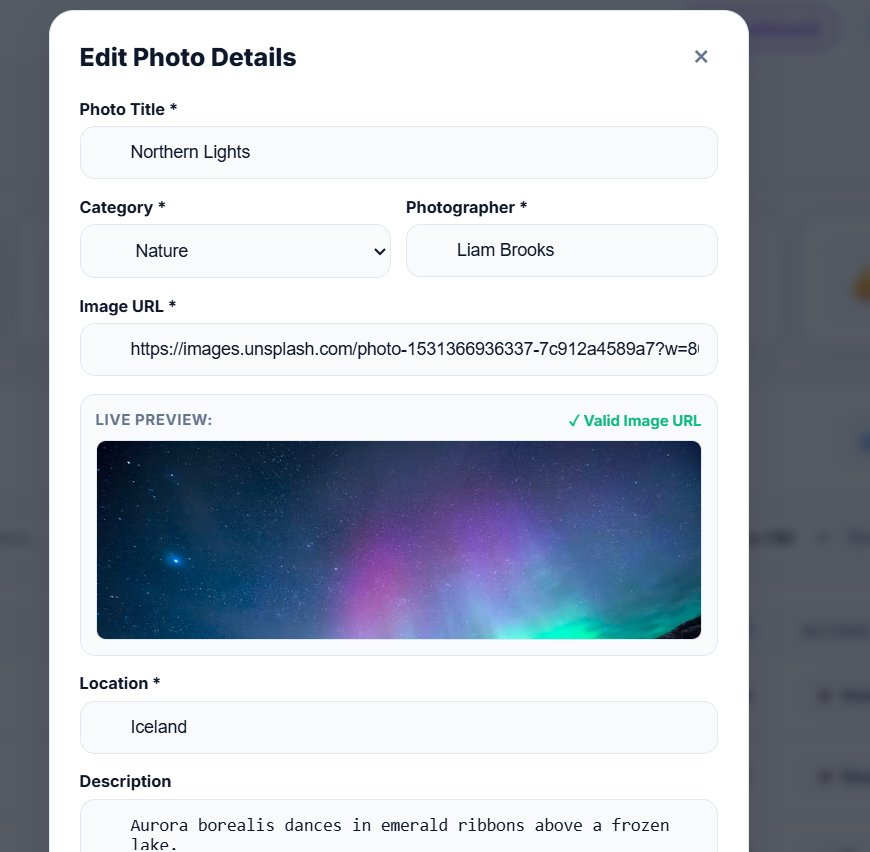

# 📸 SnapSphere — Curated Photo Gallery & Management Platform (MERN)

[](https://react.dev/)
[](https://reactrouter.com/)
[](https://nodejs.org/)
[](https://www.mongodb.com/)
[](LICENSE)

A modern, fast, and responsive full-stack photo gallery web application designed for photographers and visual storytellers. Built with the **MERN Stack** (**React 19**, **Node.js**, **Express**, **MongoDB Atlas / Mongoose**, and **CSS3**), **SnapSphere** pairs an immersive exploration experience for users with a powerful administrative dashboard for catalog maintenance, live metric tracking, and user management.

---

## 👨‍💻 Author

**Adil Mairaj**  
* GitHub: [@adilmairaj-dev](https://github.com/adilmairaj-dev)
* Repository: [Snap-Sphere](https://github.com/adilmairaj-dev/Snap-Sphere)

---

## ✨ Features

### 👤 Customer & Visitor Experience
* **Curated Gallery Grid**: High-resolution photography presented in an adaptive responsive grid with fluid hover interactions and metadata overlays.
* **Real-time Live Search**: Instant multi-attribute search filtering photos on-the-fly by title, photographer, location, and description.
* **Category Exploration**: Quick category filter pills covering **All**, **Nature**, **Architecture**, **Animals**, **People**, and **Travel**.
* **Deep Photo Inspection (`/photo/:id`)**: Comprehensive detail view featuring high-res previews, photographer information, shot location, like counters, direct high-speed image downloads, and curated "More in Category" recommendations.
* **Instant Likes & Favourites**: Toggle likes with immediate community count feedback and save shots to your personal favorites.
* **My Collection (`/collection`)**: Dedicated user collection space featuring categorized tabs to browse *Total Liked Photos* and *Favourites Saved*.
* **Dark & Light Mode Switcher**: Seamless theme switcher with persistent session storage and custom CSS design tokens.

### 🛡️ Administration Dashboard (`/admin`)
* **Real-time Platform Metrics**:
  * **Total Gallery Photos**: Live catalog count across all categories.
  * **👥 Our Users Modal**: Interactive modal listing registered user emails, active status indicators, and session timestamps.
  * **📸 Photographers Modal**: Artist directory showcasing unique photographers, location tags, total community likes, and an interactive horizontal preview reel.
  * **👍 Total Likes**: Aggregate community engagement tally across the entire catalog.
* **Catalog Management Table**:
  * Multi-attribute search and category filtering directly within the admin view.
  * Multi-directional sorting (**Newest Added**, **Oldest Added**, **Most Liked**, **Title A-Z / Z-A**).
  * Direct table actions: View in Gallery, Edit details, and one-click Delete.
  * Responsive view switcher (**Auto**, **Table View**, **Cards View**) with customized horizontal scrolling.
* **Add & Edit Photo Workflows**:
  * Live URL validation with real-time preview before publishing.
  * Smooth modal scrollbar with overflow control for clean usability across all screen heights.

---

## 📸 Application Screenshots

### 🌟 Customer Experience & Public Gallery
| 01. Gallery Home (Dark Mode & Filters) | 02. Photo Detail Page (Metadata & Likes) |
| :---: | :---: |
|  |  |

| 03. Unified Login Portal | 04. User Profile & Navigation Menu |
| :---: | :---: |
|  |  |

| 05. My Collection (Liked & Favourites) |
| :---: |
|  |

### 🛡️ Administration & Catalog Management
| 06. Live Admin Dashboard & Metrics | 07. Real-Time Category Filtering |
| :---: | :---: |
|  |  |

| 08. Registered Users Modal | 09. Featured Photographers Modal |
| :---: | :---: |
|  |  |

| 10. Add New Photo Modal | 11. Edit Photo Details Modal |
| :---: | :---: |
|  |  |

---

## 🛠️ Tech Stack

### Frontend
* **Framework**: React 19 (SPA Architecture)
* **Routing**: React Router v6
* **Styling**: Vanilla CSS3 with Custom Properties (Theme tokens, CSS Grid, Flexbox, Keyframe Animations)
* **Testing**: Jest & React Testing Library (100% passing test suite)

### Backend
* **Runtime**: Node.js (CommonJS)
* **Framework**: Express.js
* **Database**: MongoDB Atlas with Mongoose ODM
* **Authentication**: JSON Web Tokens (JWT) & bcrypt.js password hashing
* **Data Seeding**: Automatic initial seeder populating 16 curated high-resolution photography records

---

## 📂 Project Structure

```text
snap-sphere/
├── client/                     # ⚛️ React 19 Frontend
│   ├── public/                 # Static assets, index.html, favicon
│   ├── src/
│   │   ├── components/         # Navbar, Footer, Modals, Card views
│   │   ├── pages/              # GalleryHome, PhotoDetail, AdminPage, MyCollection, Login
│   │   ├── utils/              # Storage helpers, API utilities, download handler
│   │   ├── App.jsx             # Main router & theme provider
│   │   ├── App.css             # Design tokens & responsive styles
│   │   └── App.test.js         # Comprehensive unit tests
│   ├── package.json
│   └── .gitignore
│
├── server/                     # 🚀 Node.js + Express Backend
│   ├── middleware/             # JWT authentication & admin authorization guards
│   ├── models/                 # Mongoose schemas (Photo.js, User.js)
│   ├── routes/                 # REST API endpoints (photoRoutes.js, authRoutes.js)
│   ├── seedData.js             # 16 Curated photos auto-seeder
│   ├── server.js               # Express application entry & MongoDB connection
│   ├── .env.example            # Sample environment variables
│   ├── package.json
│   └── .gitignore
│
├── docs/                       # 📸 Application Documentation & Screenshots
│   └── screenshots/
│
├── .gitignore                  # Security-first root ignore rules (protects .env and secrets)
├── LICENSE                     # MIT License
└── README.md                   # Project documentation
```

---

## 🚀 Getting Started

### 1. Prerequisites
* **Node.js**: v16 or higher
* **npm**: v8 or higher
* **MongoDB**: A local MongoDB instance or free [MongoDB Atlas](https://www.mongodb.com/atlas) cluster

### 2. Backend Setup
```bash
cd server
npm install

# Configure environment variables
cp .env.example .env
# Edit server/.env and add your MONGO_URI and JWT_SECRET

# Seed catalog & start server
node seedData.js
npm start
# or with live reload:
npm run dev
```
The backend API server runs on `http://localhost:5000`.

### 3. Frontend Setup
```bash
cd client
npm install

# Start React development server
npm start
```
Open your browser and navigate to `http://localhost:3000`.

---

## 🔐 Environment Variables (`server/.env`)

```env
PORT=5000
MONGO_URI=mongodb+srv://<username>:<password>@cluster.mongodb.net/snapsphere
JWT_SECRET=your_jwt_secret_key_here
ADMIN_EMAIL=admin@bwu.edu
ADMIN_PASSWORD=admin123
```

---

## 🧪 Testing

To run the frontend unit & integration test suite:
```bash
cd client
npm test
```

---

## 📄 License

This project is licensed under the [MIT License](LICENSE) — created by **Adil Mairaj**.
